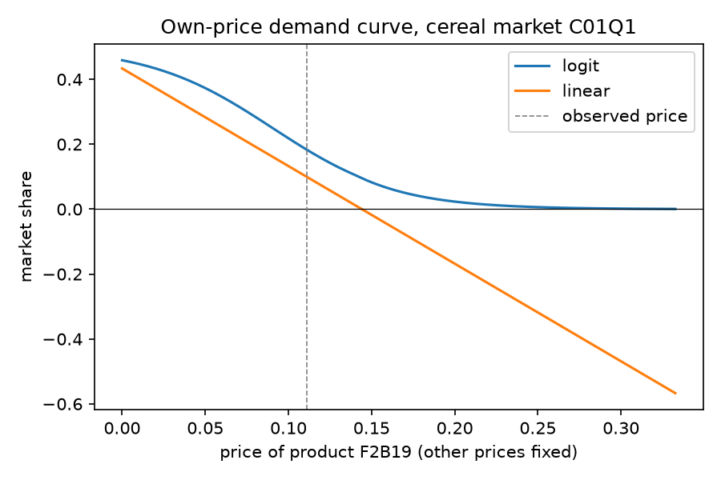
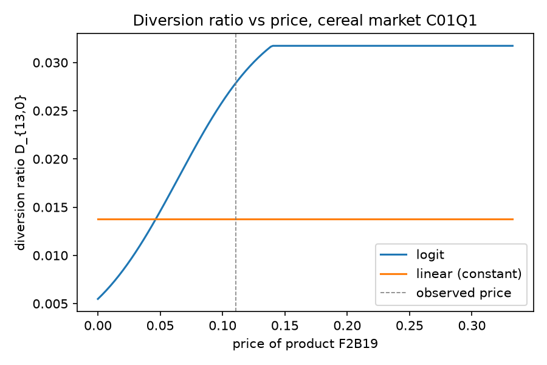
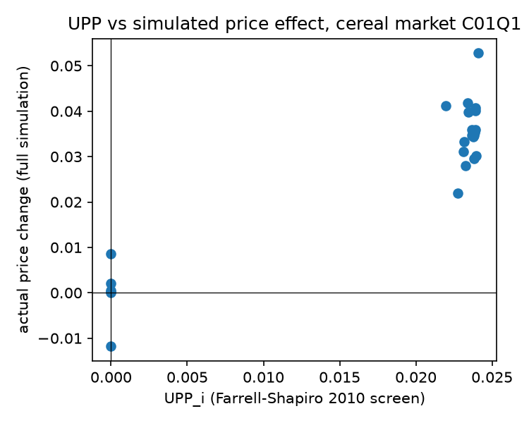
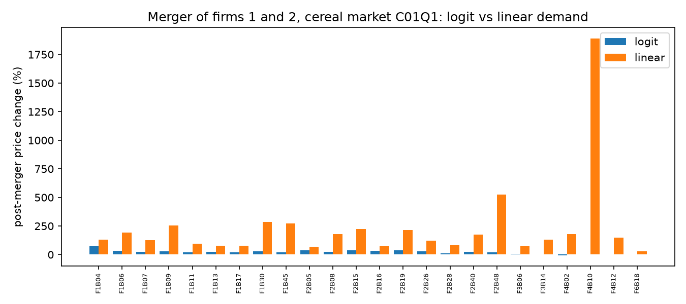

# Calibrated merger simulation: how it works, and logit vs. linear demand

> LaTeX version (canonical, with full step-by-step derivations, worked examples and exercises, for PDF): [calibrated_merger_simulation.tex](calibrated_merger_simulation.tex) / [compiled PDF](calibrated_merger_simulation.pdf) — compile from `docs/` with `pdflatex calibrated_merger_simulation.tex` (twice). This Markdown mirrors it for GitHub rendering; the key derivations are summarized in the appendix at the bottom.

This note explains the mechanics of the calibrated merger simulation implemented in
`python/mergersim/`, with the math behind each step, a side-by-side comparison of
**logit** and **linear** demand, figures, and pointers to the exact lines of code that
implement each piece. The literature behind the method is reviewed in
[docs/literature.md](literature.md) (Farrell & Shapiro 1990/2010; Hausman, Leonard &
Zona 1994; Werden & Froeb 1994; BLP/Nevo; Peters 2006; surveys by Budzinski & Ruhmer
2010 and Nevo & Whinston 2010).

---

## 1. The three-step recipe

A calibrated merger simulation predicts the effect of a hypothetical horizontal merger
using only **pre-merger** data. The standard recipe (Hausman–Leonard–Zona 1994;
Werden & Froeb 1994) has three steps:

1. **Calibrate demand** for the $J$ products in the market from observed shares $s_j$,
   prices $p_j$ and margins $m_j = p_j - c_j$. Implemented in
   `LogitDemand.calibrate` (`python/mergersim/demand.py:28`) and
   `LinearDemand.calibrate` (`python/mergersim/demand.py:112`), dispatched by
   `Market.calibrated(..., demand_type=...)` (`python/mergersim/market.py:25`).
2. **Impute marginal costs** $c_j = p_j - m_j$ from the pre-merger Nash–Bertrand
   first-order conditions (FOCs) — this is what makes the price coefficient(s) of the
   demand system identified. See §3–§4.
3. **Re-solve the pricing game** under the post-merger ownership matrix $\Omega^{post}$
   and compare equilibria: prices, shares, HHI, diversion ratios, upward pricing
   pressure (UPP), profits and consumer surplus. Implemented in `simulate_merger`
   (`python/mergersim/simulation.py:58`); equilibrium solving in
   `Market.solve_prices` (`python/mergersim/market.py:72`).

A lighter-weight screen that skips step 3 is **UPP** (Farrell & Shapiro 2010), computed
in `upward_pricing_pressure` (`python/mergersim/simulation.py:45`) — see §6.

## 2. Setup and notation

One market with $J$ differentiated products, market size $M$ (population; per-capita
analysis is $M=1$), and firms $f = 1..F$ with ownership matrix
$\Omega_{ij} = 1\{\text{products } i,j \text{ owned by the same firm}\}$
(`Market.ownership`, `python/mergersim/market.py:48`). Quantities $q_j = M s_j$.
Firms set prices simultaneously (Nash–Bertrand); firm $f$ maximises
$$\pi_f = \sum_{j \in f} (p_j - c_j)\, q_j .$$

## 3. Demand systems

### 3.1 Logit demand — `LogitDemand` (`python/mergersim/demand.py:19`)

Mean utility $\delta_j = \beta_j - a\, p_j$ with outside good $\delta_0 = 0$, so
$$s_j(p) = \frac{e^{\delta_j}}{1 + \sum_k e^{\delta_k}}, \qquad s_0 = 1 - \sum_j s_j .$$
`LogitDemand.shares` (`demand.py:55`) evaluates this; the price coefficient is stored
as `a = -alpha > 0` and `delta_j = intercepts_j - a * p_j`.

**Calibration** (`demand.py:28`): invert the share equation,
$\delta_j = \ln s_j - \ln s_0$, and use the pre-merger FOC of a single-product firm,
$$p_j - c_j = \frac{1}{a\,(1 - s_j)} \quad\Rightarrow\quad a = \mathrm{mean}_j \frac{1}{(p_j - c_j)(1 - s_j)} ,$$
then $\beta_j = \delta_j + a\, p_j$. (With multi-product firms the per-product values
differ; averaging is the standard practical fix, as in HLZ 1994.)

**Elasticities** (`demand.py:71`): $\partial s_j/\partial p_j = -a\, s_j (1-s_j)$,
$\partial s_j/\partial p_k = a\, s_j s_k$ ($k \neq j$); the full Jacobian
$A_{ji} = \partial s_j/\partial p_i$ is `demand.py:66`.

**Diversion ratios** (`demand.py:77`): $D_{ij} = \dfrac{\partial s_j/\partial p_i}{-\partial s_i/\partial p_i} = \dfrac{s_j}{1 - s_i}$
— share-proportional, and *varying with prices* (see Fig. 2).

**Consumer surplus** (`demand.py:84`): closed form
$$CS(p) = \frac{1}{a}\ln\Big(1 + \sum_j e^{\delta_j(p)}\Big) \quad \text{(per capita; total } = M \cdot CS).$$

### 3.2 Linear demand — `LinearDemand` (`python/mergersim/demand.py:92`)

Per-capita linear demand over the inside goods only (no outside good):
$$s(p) = a - B\, p, \qquad q = M\, s, \qquad B_{ji} = -\frac{\partial s_j}{\partial p_i},$$
with $B_{jj} > 0$ and $B_{ij} \le 0$ for substitutes. `shares` is `demand.py:132`,
the Jacobian is the constant matrix $-B$ (`demand.py:141`).

**Calibration** (`demand.py:112`) — and here is the key identification difference vs.
logit. The pre-merger FOC of a single-product firm gives only the **own slope**:
$$q_j = m_j\,(-\partial q_j/\partial p_j) \;\Rightarrow\; B_{jj} = \frac{s_j}{m_j} \quad \text{(per capita)}.$$
The **cross slopes are not identified** from one market's $(s, p, m)$: they require
diversion ratios, because $D_{ij} = -B_{ij}/B_{jj}$, i.e.
$$B_{ij} = -D_{ij}\, B_{jj} \quad (i \neq j).$$
By default the code proxies $D_{ij} = s_j/(1-s_i)$ (share-proportional, the logit
formula, as in Farrell & Shapiro 2010's $REC \cdot s_j/(1-s_i)$); pass
`diversion=` to `Market.calibrated` / `LinearDemand.calibrate` to use estimated
diversion ratios. Intercepts then follow from $a = s + Bp$.

**Closed-form equilibrium** (`demand.py:165`): with linear demand the FOCs are a
linear system, so the Nash–Bertrand equilibrium has the exact solution
$$p^{*} = (B + B^{\top}\Omega)^{-1}\,(a + B^{\top}\Omega\, c) .$$
`Market.solve_prices` (`market.py:72`) uses this whenever the demand object provides
`closed_form_prices`.

**Consumer surplus** (`demand.py:157`): exact quadratic form of the underlying
quasi-linear utility, with $\alpha = B^{-1}a$:
$$CS(p) = \alpha^{\top} s - \tfrac12 s^{\top} B^{-1} s - p^{\top} s .$$

**Caveats** (visible in the figures below): shares can go **negative** at high prices
(Fig. 1), inside shares sum to one (no outside good — unlike the cereal data, where
inside shares sum to $\approx 0.70$), diversion ratios are **constant** in prices
(Fig. 2), and niche products can get implausible "corner" prices after a merger
(Fig. 3, +525% on a 0.2%-share product; one product's simulated share goes negative).

### 3.3 Logit vs. linear at a glance

| property | logit | linear |
|---|---|---|
| shares | bounded in $(0,1)$, outside good $s_0>0$ | can go negative; $\sum_j s_j = 1$ |
| price coefficient(s) identified from $(s,p,m)$ | one scalar $a$ | own slopes $B_{jj}$ only; cross slopes need diversion $D$ |
| diversion $D_{ij}$ | $s_j/(1-s_i)$, varies with prices | $-B_{ij}/B_{jj}$, constant |
| post-merger equilibrium | numerical (fixed point + root finding) | closed form $p^{*}=(B+B^{\top}\Omega)^{-1}(a+B^{\top}\Omega c)$ |
| consumer surplus | closed form $\frac1a\ln(1+\sum e^{\delta})$ | quadratic form |
| code | `demand.py:19–90` | `demand.py:92–168` |



**Fig. 1** — own-price demand curve for product F2B19 in cereal market C01Q1
(calibrated at the observed price, dashed line), other prices fixed. The logit curve
stays in $(0,1)$ and flattens as the outside good absorbs demand; the linear curve is
a straight line that crosses zero. Generated by `python/examples/make_figures.py:20`.



**Fig. 2** — diversion ratio $D_{ij}$ as the price of product $i$ varies: logit's
share-proportional diversion falls as $p_i$ rises (and $s_i \to 0$); linear's is
constant. Same script as Fig. 1.

## 4. Supply side: FOCs, ownership matrix, equilibrium

Firm $f$'s FOC for product $i \in f$ (per capita, dividing by $M$):
$$r_i(p) = s_i + \sum_{k:\, \Omega_{ik}=1} (p_k - c_k)\, \frac{\partial s_k}{\partial p_i} = 0 .$$
This is `Market.foc` (`python/mergersim/market.py:63`), generic over the demand class
(it uses `demand.shares` and `demand.jacobian`).

`Market.solve_prices` (`market.py:72`) collects candidate solutions and returns the one
with the smallest FOC residual:

- **linear demand**: the closed form above (`demand.py:165`);
- **logit demand**: the markup fixed-point iteration (Morrow–Skerlos 2011 style),
  $$m_i \leftarrow \frac{1/a + \sum_{j \in f,\, j \neq i} m_j s_j}{1 - s_i}, \qquad p_i = c_i + m_i ,$$
  implemented in `Market._fixed_point` (`market.py:96`);
- **both**: `scipy.optimize.root` on the FOCs as a fallback/refinement.

Pre-merger, the observed prices should satisfy the FOCs (this is what identifies
costs/demand); the test `test_premerger_foc_holds`
(`python/tests/test_mergersim.py:39`) checks this on a synthetic market, and
`test_calibration_recovers_a` / `test_calibration_recovers_B`
(`python/tests/test_linear.py:12`) check that calibration recovers the true demand
parameters exactly.

## 5. The merger simulation algorithm — `simulate_merger` (`python/mergersim/simulation.py:58`)

Given a calibrated `Market` and the merging firms $M_{set}$:

1. **New ownership**: all products of firms in $M_{set}$ get one firm id →
   $\Omega^{post}$ (lines 64–66 of `simulation.py`).
2. **Efficiencies**: `efficiency` $E$ is a proportional marginal-cost saving on the
   merging firms' products: $c_j^{post} = (1-E) c_j$ (lines 67–69).
3. **Re-solve equilibrium**: $p^{post}$ = `Market.solve_prices` under $\Omega^{post}$,
   starting from observed prices (line 71).
4. **Compare**: `_snapshot` (`simulation.py:31`) computes for pre and post: prices,
   shares, quantities, margins, per-firm profits (`Market.profits`, `market.py:110`),
   HHI on inside shares renormalised to sum to 1 (`Market.hhi`, `market.py:58`), and
   consumer surplus $M \cdot CS(p)$.
5. **Diagnostics**: UPP (§6), diversion matrix, per-product table via `report`
   (`simulation.py:86`).

Usage (see `python/examples/run_cereal_merger.py:13`):

```python
m = nevo_market("C01Q1", lerner=0.3, demand_type="logit")   # or "linear"
res = simulate_merger(m, merging_firms=[1, 2], efficiency=0.05)
table, summary = report(res)   # per-product price/share changes + UPP; HHI/CS/profit
```

## 6. Diagnostics

**Upward pricing pressure** (Farrell & Shapiro 2010; verified against the open-access
paper), `upward_pricing_pressure` (`simulation.py:45`): for each product $i$ of the
merging firms,
$$UPP_i = \sum_{j \in M_{set},\, j \neq i} D_{ij}\,(p_j - c_j) \;-\; E_i\, c_i .$$
Under logit, $D_{ij} = s_j/(1-s_i)$; under linear, $D_{ij} = -B_{ij}/B_{jj}$.
UPP predicts the *sign* of the price effect robustly, not the magnitude:



**Fig. 4** — UPP$_i$ vs. the full-simulation price change $\Delta p_i$ (logit, cereal
C01Q1, firms 1+2): positive UPP ⇔ positive $\Delta p$, but magnitudes differ.

**HHI**: `Market.hhi` (`market.py:58`), $10000 \sum_f (s_f / \sum_g s_g)^2$.
**Diversion**: `demand.diversion_ratios` (`demand.py:77` / `:151`).
**Welfare**: consumer surplus + total profit, pre vs post (`report`).

## 7. Numerical illustration: same merger, two demand forms

Cereal market C01Q1 (24 products, 5 firms), constant Lerner margin 0.3 (the data has no
cost column), merger of firms 1 and 2, no efficiencies. Run:
`PYTHONPATH=python python python/examples/run_logit_vs_linear.py` (`examples/run_logit_vs_linear.py:14`).

| | logit | linear |
|---|---|---|
| mean Δp of merging products | **+29.6%** (max +73.2%) | +176.9% (max +525.5%) |
| min post-merger share | +0.0027 (valid) | **−0.59** (invalid — linear pathology) |
| HHI | 3593 → 4134 | 3593 → 2890 (meaningless, negative shares) |
| consumer surplus | 0.0221 → 0.0127 | 0.0227 → 0.0143 |
| total profit | 0.0312 → 0.0515 | 0.0170 → 0.2497 |
| max UPP | 0.0241 | 0.0130 |

For a smaller merger (firms 1+3) where linear shares stay positive, the two models
agree more closely: logit +13.3% vs linear +18.0% mean price change. Takeaways: both
models predict the same *sign* (prices rise, CS falls, profits rise — the no-synergy
result of Farrell & Shapiro 1990), but **magnitudes are sensitive to the demand form**
(Crooke, Froeb, Tschantz & Werden 1999), and linear demand can produce invalid
(negative) shares and implausible corner prices for niche products — which is why
logit (or richer systems) dominates agency practice.



**Fig. 3** — per-product post-merger price change, merger of firms 1+2 in cereal market
C01Q1, logit vs linear. Generated by `python/examples/make_figures.py:20`.

## 8. Code map

| file | symbol | line | what it does |
|---|---|---|---|
| `python/mergersim/demand.py` | `LogitDemand` | 19 | logit shares/Jacobian/elasticities/diversion/CS; calibration at 28 |
| `python/mergersim/demand.py` | `LinearDemand` | 92 | linear `s = a − Bp`; calibration at 112 (needs diversion for cross slopes); closed-form prices at 165 |
| `python/mergersim/market.py` | `Market.calibrated` | 25 | builds a market from data, `demand_type="logit"\|"linear"` |
| `python/mergersim/market.py` | `Market.foc` / `solve_prices` / `_fixed_point` | 63 / 72 / 96 | Nash–Bertrand FOCs and equilibrium solvers |
| `python/mergersim/market.py` | `Market.hhi`, `ownership`, `profits`, `equilibrium` | 58, 48, 110, 119 | diagnostics; synthetic equilibrium builder |
| `python/mergersim/simulation.py` | `simulate_merger` | 58 | the merger counterfactual (§5) |
| `python/mergersim/simulation.py` | `upward_pricing_pressure` | 45 | F&S 2010 UPP screen |
| `python/mergersim/simulation.py` | `report` | 86 | pre/post tables (prices, shares, UPP, HHI, CS, profit) |
| `python/mergersim/data.py` | `nevo_market`, `synthetic_market`, `synthetic_linear_market` | 27, 51, 81 | cereal loader; synthetic logit/linear markets |
| `python/examples/` | `run_cereal_merger.py`, `run_logit_vs_linear.py`, `run_synthetic.py`, `make_figures.py` | 13, 14, 13, 20 | runnable examples; figure generation for this note |
| `python/tests/` | `test_mergersim.py`, `test_linear.py` | — | 19 tests: calibration recovery, FOC validity, merger price/CS/HHI/UPP properties, demand-form differences |

## 9. Limitations and natural extensions

- **Richer demand**: nested logit, random-coefficients logit (BLP 1995; Nevo 2001) —
  estimation via PyBLP (`pyblp`), then feed estimated parameters into the same
  `Market`/`simulate_merger` machinery; AIDS (Hausman et al. 1994) as an alternative.
- **Multi-market**: loop `nevo_market` over all 94 cereal markets and average effects.
- **Efficiencies** (`efficiency=` in `simulate_merger`), **product repositioning**,
  **entry**, and **dynamic** effects (Doraszelski & Markovich 2008) are not modelled.
- **Bargained prices** (hospitals, Gowrisankaran–Nevo–Town 2015) need a different
  conduct assumption than Nash–Bertrand.
- **Linear demand caveats** (§3.2): use it for small price changes / teaching; prefer
  logit+ when an outside good matters or price changes are large.

## 10. References

See [docs/literature.md](literature.md) for the full annotated list with links:
Farrell & Shapiro (1990, 2010); Hausman, Leonard & Zona (1994); Werden & Froeb
(1994); Crooke et al. (1999); Froeb, Tschantz & Werden (2005); Epstein & Rubinfeld
(2001); Berry (1994); Berry, Levinsohn & Pakes (1995); Nevo (2000, 2001); Ivaldi &
Verboven (2005); Peters (2006); Björnerstedt & Verboven (2016); Miller & Weinberg
(2017); Gowrisankaran, Nevo & Town (2015); Nocke & Schutz (2018); Doraszelski &
Markovich (2008); Budzinski & Ruhmer (2010); Nevo & Whinston (2010); DOJ/FTC Merger
Guidelines.

## Appendix: the key derivations, step by step

(Full versions with numbered equations, figures and exercises are in the [LaTeX/PDF](calibrated_merger_simulation.pdf), §3–§6 and §9.)

**Logit shares and inversion.** With $u_{hj} = \delta_j + \varepsilon_{hj}$, $\varepsilon$ iid type-I EV, and $\delta_0 = 0$:
$s_j = e^{\delta_j}/(1+\sum_k e^{\delta_k})$, so $\delta_j = \ln s_j - \ln s_0$ with $s_0 = 1-\sum_j s_j$. With $\delta_j = \beta_j - a p_j$:

**Logit Jacobian** (quotient rule, $D = 1+\sum_k e^{\delta_k}$):
$\partial s_j/\partial p_j = [e^{\delta_j}(-a)D - e^{\delta_j}e^{\delta_j}(-a)]/D^2 = -a s_j(1-s_j)$; for $k\neq j$, $\partial s_j/\partial p_k = a s_j s_k$. Elasticities: $\varepsilon_{jj} = -a p_j(1-s_j)$, $\varepsilon_{jk} = a p_k s_j$. Code: `demand.py:66,71`.

**Logit calibration of $a$** from a single-product firm's FOC:
$0 = s_j + (p_j-c_j)\partial s_j/\partial p_j = s_j[1 - a(p_j-c_j)(1-s_j)] \Rightarrow a = 1/[(p_j-c_j)(1-s_j)]$, averaged over products. Code: `demand.py:28`.

**Logit diversion**: $D_{ij} \equiv -(\partial s_j/\partial p_i)/(\partial s_i/\partial p_i) = s_j/(1-s_i)$. Code: `demand.py:77`.

**Logit CS**: expected max utility $V(p) = (1/a)\ln(1+\sum_j e^{\delta_j(p)})$; Roy: $s_j = -\partial V/\partial p_j$; quasi-linear $\Rightarrow \Delta CS = M[V(p^1)-V(p^0)]$. Code: `demand.py:84`.

**Linear demand** $s = a - Bp$ comes from quadratic utility $U(s) = \alpha's - \frac12 s'B^{-1}s$ with $a = B\alpha$. Calibration: own slopes from FOC $B_{jj} = s_j/m_j$; cross slopes need diversion, $B_{ji} = -D_{ij}B_{ii}$ (default proxy $D_{ij}=s_j/(1-s_i)$). Code: `demand.py:112`.

**Linear closed-form equilibrium**: FOC vector $r = s - B^{\top}(\Omega m) = 0$ with $s = a-Bp$, $m = p-c$ gives $p^{*} = (B+B^{\top}\Omega)^{-1}(a + B^{\top}\Omega c)$. Code: `demand.py:165`.

**Multi-product FOC**: $r_i = s_i + \sum_k \Omega_{ik} m_k A_{ki} = 0$, $A_{ki} = \partial s_k/\partial p_i$. Code: `market.py:63`.

**Logit fixed point** (solve the FOC for $m_i$): $m_i = (1/a + \sum_{k\in f, k\neq i} m_k s_k)/(1-s_i)$, $p_i = c_i + m_i$. Code: `market.py:96`.

**UPP, two-product derivation** (Farrell–Shapiro 2010): pre-merger $1/a = m_i(1-s_i)$; post-merger FOC $s_i - a m_i' s_i(1-s_i) + a m_j s_i s_j = 0$ with $m_i' = p_i - (1-E_i)c_i$. Linearising around pre-merger prices: $\Delta p_i = m_j s_j/(1-s_i) - E_i c_i = D_{ij}(p_j-c_j) - E_i c_i = UPP_i$. Multi-product: $UPP_i = \sum_{j\in M, j\neq i} D_{ij}m_j - E_i c_i$. Code: `simulation.py:45`. Worked example: $s_i=s_j=0.2$, $p=\$1$, $c=\$0.70$ $\Rightarrow$ $D=0.25$, $UPP = 0.25\times0.30 = \$0.075$.
